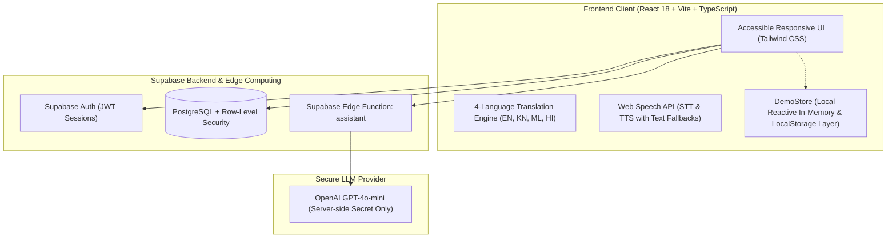

# CareConnect — Multilingual, Privacy-First Elder-Care Platform

CareConnect is a compassionate, privacy-first elder-care coordination platform designed for older adults living alone and their trusted caregivers. It bridges communication through accessible native Indian language support (**English**, **ಕನ್ನಡ - Kannada**, **മലയാളം - Malayalam**, **हिंदी - Hindi**), simplified daily wellbeing check-ins, health reminders, manually entered health readings, and a transparent help-request workflow.

> [!IMPORTANT]
> **Medical Disclaimer**: CareConnect is a supportive coordination tool, **not a medical diagnostic system**. It does not measure blood pressure, glucose, or vitals via hardware, nor does it prescribe medication. In medical emergencies, users are directed to call National Emergency Services (**112**) or the Elder Helpline (**14567**).

---

## 1. Architecture & Tech Stack



- **Frontend**: React 18, TypeScript, Vite, Tailwind CSS, Lucide React icons.
- **Backend & Database**: Supabase (PostgreSQL 15+, Row-Level Security on every table).
- **Authentication**: Supabase Auth (Role-based access: `senior`, `caregiver`, `admin`).
- **AI Integration**: Supabase Edge Function (`/functions/v1/assistant`) calling OpenAI `gpt-4o-mini` with strict non-diagnostic system prompts and multilingual output.
- **Speech Integration**: Web Speech API (`SpeechRecognition` & `SpeechSynthesis`) with language tags (`kn-IN`, `ml-IN`, `hi-IN`, `en-IN`), microphone indicators, and robust text-input fallbacks.
- **Demo Mode**: Real-time cross-role interactive evaluation bar with 4 pre-seeded personas.

---

## 2. Core Features & Capabilities

### Older Adult Experience
- **Big 3 Daily Actions**:
  - `I'm okay` (Green): Records wellbeing and updates caregiver status.
  - `I want to talk` (Amber): Prompts caregiver for a friendly voice call.
  - `I need help` (Red): Automatically triggers an urgent help request.
- **Trusted Contact Card**: Quick one-tap phone dialer and contact card for their linked caregiver.
- **Health & Reminders**:
  - Manually entered Blood Pressure (`120/80 mmHg`) and Blood Glucose (`mg/dL`) with input validation.
  - Transparent labeling: *"Entered by user"* vs *"Entered by caregiver"*.
  - Medicine and appointment reminders with time and recurrence (`daily`, `weekly`, `once`).
- **Multilingual AI Assistant**:
  - Supports speech-to-text and text-to-speech audio playback.
  - 3 quick prompt suggestions in current language: *"Explain my reminder"*, *"Contact my family"*, *"I need assistance"*.
  - Explicit confirmation modal before creating any help request.
  - Strict guardrails preventing medical diagnosis.
- **Help Request Tracking**: Live status badges: `Pending` ⏳ → `Acknowledged` 👁️ → `Handled` ✅ with timestamps and cancellation support.

### Caregiver Dashboard
- **Linked Older Adults Overview**: Isolated view showing only seniors who have accepted a link.
- **Check-in Monitoring**: Differentiates between *"I'm okay"*, *"Wants a call"*, *"Needs help"*, and *"Missed check-in"*. (Missed check-ins are explicitly documented as needing gentle follow-up, never labeled as confirmed medical emergencies).
- **Request Lifecycle Queue**: Filter by Pending, Acknowledged, Handled. Action buttons record caregiver assignment and completion timestamps.
- **Granular Privacy Permissions**: Caregivers only view health readings or check-ins when senior has consented (`share_health_readings`, `share_checkins`).

---

## 3. Instant Demo Mode (No Setup Required)

CareConnect is pre-configured with a **Demo Mode Switcher** at the top of the interface:

| Persona | Role | Default Language | Email (for login) | Password |
|---|---|---|---|---|
| **👵 Kamala Devi** | Senior | ಕನ್ನಡ (Kannada) | `demo.senior@careconnect.app` | `demo1234` |
| **👴 Rajan Nair** | Senior | മലയാളം (Malayalam) | `demo.senior2@careconnect.app` | `demo1234` |
| **👩‍⚕️ Priya Sharma** | Caregiver | English | `demo.caregiver@careconnect.app` | `demo1234` |
| **👨‍⚕️ Arun Kumar** | Caregiver | हिंदी (Hindi) | `demo.caregiver2@careconnect.app` | `demo1234` |

### 6-Step Demonstration Journey:
1. Open the app — it loads directly into **Demo Mode** with **👵 Kamala Devi** (Kannada).
2. Click **"ನನಗೆ ಸಹಾಯ ಬೇಕು" (I Need Help)** or submit a check-in.
3. Use the top Demo Bar to switch in 1 click to **👩‍⚕️ Priya Sharma (Caregiver)**.
4. On Priya's dashboard, see Kamala's new pending request under **"All Requests"**.
5. Click **"Acknowledge Request"** or **"Mark Handled"**.
6. Switch back to **👵 Kamala Devi** — observe the live status banner update to **Acknowledged** with the caregiver's timestamp!

---

## 4. Setup & Running Locally

### Prerequisites
- Node.js (v18+ or v20+)
- npm

### Installation
```bash
# 1. Clone repository
git clone https://github.com/your-username/CareConnect.git
cd CareConnect

# 2. Install dependencies
npm install

# 3. Start development server
npm run dev
```

Visit `http://localhost:5173` in your browser. The app runs immediately in Demo Mode!

---

## 5. Supabase Database & Security Setup

To connect to a live Supabase project:

### 1. Copy Environment Variables
```bash
cp .env.example .env
```
Fill in your Supabase project credentials in `.env`:
```env
VITE_SUPABASE_URL=https://your-project-id.supabase.co
VITE_SUPABASE_ANON_KEY=your_supabase_anon_key
```

### 2. Apply Database Migrations
Run the SQL migration scripts in your Supabase SQL Editor in this order:
1. `supabase/migrations/20261010100643_create_careconnect_schema_v1.sql` (Creates core tables, foreign keys, indexes, and all RLS policies).
2. `supabase/migrations/20261010100718_seed_demo_data.sql` (Seeds demo auth users, links, readings, and reminders).

### 3. Deploy Supabase Edge Function for AI Assistant
```bash
# Login to Supabase CLI
supabase login
supabase link --project-ref your-project-id

# Set secret for server-side OpenAI integration
supabase secrets set OPENAI_API_KEY=your-openai-api-key

# Deploy the function
supabase functions deploy assistant
```

---

## 6. Security & Row-Level Security (RLS) Verification

Every table containing personal health data has RLS enabled:

- `profiles`: Users can read/update their own profile. Linked caregivers can read profiles of accepted seniors only.
- `caregiver_links`: Participants (`senior_id` or `caregiver_id`) can inspect and manage links.
- `check_ins`: Seniors insert and read their own. Caregivers read check-ins only if an accepted link exists with `share_checkins = true`.
- `help_requests`: Seniors create, view, and cancel their own. Linked caregivers read and update status (`acknowledged`, `handled`).
- `health_readings`: Seniors view/manage their readings. Linked caregivers read only when `share_health_readings = true`.
- `reminders`: Isolated strictly to the senior.

### How to Test with 2 Separate Accounts:
1. Register Senior Account `senior@test.com` and Caregiver Account `caregiver@test.com`.
2. As the Senior, accept the link request for `caregiver@test.com`.
3. In SQL Editor, verify that running `SELECT * FROM health_readings` as the caregiver returns only the linked senior's permitted readings and zero records from unlinked seniors.

---

## 7. Testing Suite

CareConnect includes comprehensive automated tests powered by **Vitest**:

```bash
# Run automated tests
npm test

# Run TypeScript typecheck
npm run typecheck

# Run production build
npm run build
```

The test suite validates:
- **`translations.test.ts`**: Complete dictionary coverage across English, Kannada, Malayalam, and Hindi; time formatting, greetings, and fallback safety.
- **`demo-store.test.ts`**: Check-in lifecycles, help-request state transitions (`pending` → `acknowledged` → `handled`), cancellation, health reading source tags, and caregiver permission isolation.
- **`health-validation.test.ts`**: Format verification for blood pressure (`120/80`), glucose limits, and non-medical boundaries.

---

## 8. Limitations & Browser Compatibility

1. **Web Speech API**: Browser speech recognition (`SpeechRecognition`) is natively supported on Chromium-based browsers (Google Chrome, Microsoft Edge, Brave, Chrome for Android). Firefox and Safari provide text-input fallback.
2. **TTS Accents**: Text-to-speech audio playback relies on available operating system voice packs. If native Kannada or Malayalam voices are not installed on the user's OS, the browser uses the closest available speech synthesizer.
3. **No Sensor / Hardware Integration**: CareConnect intentionally does not claim to measure vitals with cameras or microphones. All health entries are transparently labeled as manually entered.
4. **No Push / SMS in Offline Demo**: In demo mode, notifications and updates are delivered instantly in-app through the reactive store. SMS and WhatsApp gateways require Twilio or equivalent cloud provider credentials.
